<a name="top"></a>

<picture>
  <source media="(prefers-color-scheme: dark)" srcset="https://capsule-render.vercel.app/api?type=waving&color=0:0d1117%2C35:431407%2C70:c2410c%2C100:f97316&height=250&section=header&text=OTMOF-OPS&fontSize=84&fontColor=ffffff&fontAlignY=38&animation=fadeIn&desc=nothing%20real%20happens%20unless%20you%20burn&descSize=21&descAlignY=60&descAlign=50">
  <source media="(prefers-color-scheme: light)" srcset="https://capsule-render.vercel.app/api?type=waving&color=0:fff7ed%2C40:fdba74%2C75:f97316%2C100:c2410c&height=250&section=header&text=OTMOF-OPS&fontSize=84&fontColor=431407&fontAlignY=38&animation=fadeIn&desc=nothing%20real%20happens%20unless%20you%20burn&descSize=21&descAlignY=60&descAlign=50">
  
</picture>

<p align="center">
  <a href="https://github.com/otmof-ops/cig-script">
    
  </a>
</p>

<p align="center">
  
  <a href="https://github.com/otmof-ops?tab=followers"></a>
  
  
</p>

<p align="center">
  <a href="#about"><kbd> 👤 about </kbd></a>&nbsp;
  <a href="#family"><kbd> 🔥 the cig family </kbd></a>&nbsp;
  <a href="#numbers"><kbd> ⏱️ numbers </kbd></a>&nbsp;
  <a href="#tools"><kbd> 🧰 tools </kbd></a>&nbsp;
  <a href="#releases"><kbd> 🚀 releases </kbd></a>&nbsp;
  <a href="#stats"><kbd> 📈 stats </kbd></a>&nbsp;
  <a href="#rules"><kbd> 📜 rules </kbd></a>
</p>

---

<a name="about"></a>
## :bust_in_silhouette: `$ cig run about.cig`

```yaml
handle:      otmof-ops
building:    the cig family, two languages, a compiler and the tools around them
flagship:    CigScript, automation scripts that can't hurt you by accident
the_rule:    nothing real happens unless you burn
stack:       Rust · Python · Bash
believes_in: dry runs you can trust, a journal for every burn, numbers you can check
right_now:   CigScript's core architecture, cig-compile's engineering design, and cig-cherry
```

**Working on:** [the VM, after LuaJIT, CPython and V8](https://github.com/otmof-ops/cig-script/issues/243) · [`cig run` on the VM](https://github.com/otmof-ops/cig-script/issues/254) · [cig-cherry, hot functions go native while `cig run` runs](https://github.com/otmof-ops/cig-script/issues/256) · [the compiler masterclass](https://github.com/otmof-ops/cig-compile/issues/98)

> [!NOTE]
> A **burn** is CigScript's word for a side effect. Reads are free; anything that changes the world sits inside a `burn { }` block, where it's journaled *before* it happens, so a run you regret can be reversed with `cig unburn`. What can't be undone, like a process you ran, is marked *irreversible* in the plan, so you see it coming.

---

<a name="family"></a>
## :fire: `$ ciginstaller install carton`

<table>
<tr>
<td width="50%" valign="top">

<a href="https://github.com/otmof-ops/cig-script"></a>

**Automation scripts that can't hurt you by accident.** A small scripting language for the jobs you'd otherwise hand to a Python file or a bash script, with one rule the others don't have: nothing changes the world outside a `burn { }` block.

- `--dry-run` runs the script for real and only *plans* the burns
- every burn journaled before it happens; `cig unburn <id>` reverses a run you regret, except the processes it ran, which the plan marks irreversible
- four kinds of **no**, each one telling you where to look

<a href="https://github.com/otmof-ops/cig-script/releases"></a> 

</td>
<td width="50%" valign="top">

<a href="https://github.com/otmof-ops/cig-compile"></a>

**Your CigScript scripts, as programs that run with nothing installed.** One file for any machine cig is released for, doing exactly what `cig run` does: the same burns, plan, journal and undo.

- `--stage b` runs the script's bytecode on cig's VM
- `cigcompile verify`, SSH signatures, a pass and a CycloneDX SBOM
- the same script, compiler and runtime make the same file on any machine

<a href="https://github.com/otmof-ops/cig-compile/releases"></a> 

</td>
</tr>
<tr>
<td width="50%" valign="top">

<a href="https://github.com/otmof-ops/cig-orchestrator"></a>

**Every language in the project, one chain, no glue script.** Runs the toolchains and scripts a project already has, with a dry run, rollback, and values passed between languages.

- knows the standard workflow of 61 toolchains
- glue scripts: 0

<a href="https://github.com/otmof-ops/cig-orchestrator/releases"></a>

</td>
<td width="50%" valign="top">

<a href="https://github.com/otmof-ops/cigar-script"></a>

**CigScript, grown deeper: three strengths, chosen per file.** The same words and the same rule, with types, ownership and more when you ask for them.

- **mild** is CigScript as it is; **medium** adds types, records, enums, `match`, modules and interfaces
- **full** adds ownership, channels, sized numbers and more, and is mostly built

<a href="https://github.com/otmof-ops/cigar-script/releases"></a> 

</td>
</tr>
<tr>
<td colspan="2" valign="top">

<a href="https://github.com/otmof-ops/cig-installer"></a>

**Install, pin, update and remove the CigScript family, one carton at a time.** Every build is checked before it runs, and every change is a journaled transaction that ends in one atomic switch; `ciginstaller rollback` puts the previous carton back. Telemetry: 0.

<a href="https://github.com/otmof-ops/cig-installer/releases"></a> 

</td>
</tr>
</table>

<details>
<summary><b>🔥 CigScript: the burn model</b></summary>
<br>

<p align="center"></p>

| | |
|---|---|
| **What you write** | an ordinary script: read files, transform data, run commands |
| **What changes the world** | only what sits inside a `burn { }` block |
| **What `--dry-run` shows** | exactly what the real run will do on the same inputs, planned through a ghost filesystem, so a step that reads what an earlier one wrote still works |
| **What happens first** | every burn is written to a journal, with a copy of what it's about to change |
| **What you can take back** | a run you regret, newest change first, with `cig unburn <id>`; processes you ran are marked irreversible in the plan, so you see them coming |

> 💡 Try any script with `cig run --dry-run` first: it plans every burn and changes nothing.

</details>

<details>
<summary><b>⚙️ cig-compile: build it, plan it, burn it, verify it, unburn it</b></summary>
<br>

<p align="center"></p>

</details>

<details>
<summary><b>🔗 cig-orchestrator: the glue script, and the chain that replaces it</b></summary>
<br>

<p align="center"></p>

</details>

<details>
<summary><b>🚬 CigarScript: three strengths</b></summary>
<br>

<p align="center"></p>

</details>

---

<a name="numbers"></a>
## :stopwatch: `$ python3 bench/compare/compare.py --rounds 31`

CigScript's 25 benchmark programs, written again in Python (all 25), JavaScript (24), Lua (21) and Rust (8), timed side by side on one machine with every run's output checked. Every number is made from the raw samples by one script and made again by a second, written apart from it.

<p align="center">
  <picture>
    <source media="(prefers-color-scheme: dark)" srcset="https://raw.githubusercontent.com/otmof-ops/otmof-ops/output/headline.svg">
    <source media="(prefers-color-scheme: light)" srcset="https://raw.githubusercontent.com/otmof-ops/otmof-ops/output/headline-light.svg">
    
  </picture>
</p>

<p align="center">
  <picture>
    <source media="(prefers-color-scheme: dark)" srcset="https://raw.githubusercontent.com/otmof-ops/otmof-ops/output/start-up.svg">
    <source media="(prefers-color-scheme: light)" srcset="https://raw.githubusercontent.com/otmof-ops/otmof-ops/output/start-up-light.svg">
    
  </picture>
</p>

Lua and LuaJIT are faster still: a stage b program takes 1.97 times Lua 5.4's time and 5.20 times LuaJIT's, and Rust is far ahead. The VM work after them is [cig-script#243](https://github.com/otmof-ops/cig-script/issues/243).

<p align="center"><a href="https://github.com/otmof-ops/cig-script/blob/main/docs/BENCHMARKS-2026-11-15.md"></a></p>

---

<a name="tools"></a>
## :toolbox: `$ ls ~/tools`

<p align="center">
  <a href="https://github.com/otmof-ops/vidpull"><picture><source media="(prefers-color-scheme: dark)" srcset="https://raw.githubusercontent.com/otmof-ops/otmof-ops/output/pin-vidpull.svg"><source media="(prefers-color-scheme: light)" srcset="https://raw.githubusercontent.com/otmof-ops/otmof-ops/output/pin-vidpull-light.svg"></picture></a>
  <a href="https://github.com/otmof-ops/briefkit"><picture><source media="(prefers-color-scheme: dark)" srcset="https://raw.githubusercontent.com/otmof-ops/otmof-ops/output/pin-briefkit.svg"><source media="(prefers-color-scheme: light)" srcset="https://raw.githubusercontent.com/otmof-ops/otmof-ops/output/pin-briefkit-light.svg"></picture></a>
  <a href="https://github.com/otmof-ops/nudge"><picture><source media="(prefers-color-scheme: dark)" srcset="https://raw.githubusercontent.com/otmof-ops/otmof-ops/output/pin-nudge.svg"><source media="(prefers-color-scheme: light)" srcset="https://raw.githubusercontent.com/otmof-ops/otmof-ops/output/pin-nudge-light.svg"></picture></a>
  <a href="https://github.com/otmof-ops/mosaic-wallpaper"><picture><source media="(prefers-color-scheme: dark)" srcset="https://raw.githubusercontent.com/otmof-ops/otmof-ops/output/pin-mosaic-wallpaper.svg"><source media="(prefers-color-scheme: light)" srcset="https://raw.githubusercontent.com/otmof-ops/otmof-ops/output/pin-mosaic-wallpaper-light.svg"></picture></a>
  <a href="https://github.com/otmof-ops/hw-temp-monitor"><picture><source media="(prefers-color-scheme: dark)" srcset="https://raw.githubusercontent.com/otmof-ops/otmof-ops/output/pin-hw-temp-monitor.svg"><source media="(prefers-color-scheme: light)" srcset="https://raw.githubusercontent.com/otmof-ops/otmof-ops/output/pin-hw-temp-monitor-light.svg"></picture></a>
</p>

---

<a name="releases"></a>
## :rocket: `$ gh release list --limit 7`

<p align="center">
  <picture>
    <source media="(prefers-color-scheme: dark)" srcset="https://raw.githubusercontent.com/otmof-ops/otmof-ops/output/releases.svg">
    <source media="(prefers-color-scheme: light)" srcset="https://raw.githubusercontent.com/otmof-ops/otmof-ops/output/releases-light.svg">
    
  </picture>
</p>

---

<a name="toolchain"></a>
## :hammer_and_wrench: `$ which cargo python3 bash`

<p align="center">
  
</p>

<p align="center">
  
  
  
  
  
</p>

---

<a name="stats"></a>
## :chart_with_upwards_trend: `$ git log --stat`

<p align="center">
  <picture>
    <source media="(prefers-color-scheme: dark)" srcset="https://raw.githubusercontent.com/otmof-ops/otmof-ops/output/stats.svg">
    <source media="(prefers-color-scheme: light)" srcset="https://raw.githubusercontent.com/otmof-ops/otmof-ops/output/stats-light.svg">
    
  </picture>
  <picture>
    <source media="(prefers-color-scheme: dark)" srcset="https://raw.githubusercontent.com/otmof-ops/otmof-ops/output/languages.svg">
    <source media="(prefers-color-scheme: light)" srcset="https://raw.githubusercontent.com/otmof-ops/otmof-ops/output/languages-light.svg">
    
  </picture>
</p>

<p align="center">
  <picture>
    <source media="(prefers-color-scheme: dark)" srcset="https://streak-stats.demolab.com?user=otmof-ops&hide_border=true&background=0d1117&ring=c2410c&fire=f97316&currStreakLabel=f97316&sideLabels=c9d1d9&dates=8b949e&currStreakNum=ffffff&sideNums=ffffff&stroke=30363d">
    <source media="(prefers-color-scheme: light)" srcset="https://streak-stats.demolab.com?user=otmof-ops&hide_border=true&background=ffffff&ring=ea580c&fire=ea580c&currStreakLabel=c2410c&sideLabels=1f2328&dates=59636e&currStreakNum=1f2328&sideNums=1f2328&stroke=d0d7de">
    
  </picture>
</p>

<p align="center">
  <picture>
    <source media="(prefers-color-scheme: dark)" srcset="https://raw.githubusercontent.com/otmof-ops/otmof-ops/output/snake.svg">
    <source media="(prefers-color-scheme: light)" srcset="https://raw.githubusercontent.com/otmof-ops/otmof-ops/output/snake-light.svg">
    
  </picture>
</p>

---

<a name="rules"></a>
## :scroll: `$ cat rules.txt`

```text
01  nothing real happens unless you burn.
02  write it down before it happens. then put it back, or say up front that you can't.
03  a dry run is a promise: on the same inputs, the real run does exactly that.
04  when it says no, say which kind of no, and where to look.
05  measure, don't guess. then check the number twice.
```

> [!WARNING]
> ~~move fast and break things~~ &nbsp;move deliberately and keep the journal.

---

<p align="center">
  <a href="https://github.com/otmof-ops?tab=repositories"></a>
  <a href="#top"></a>
</p>

<picture>
  <source media="(prefers-color-scheme: dark)" srcset="https://capsule-render.vercel.app/api?type=waving&color=0:f97316%2C30:c2410c%2C65:431407%2C100:0d1117&height=130&section=footer">
  <source media="(prefers-color-scheme: light)" srcset="https://capsule-render.vercel.app/api?type=waving&color=0:c2410c%2C45:f97316%2C100:fdba74&height=130&section=footer">
  
</picture>
